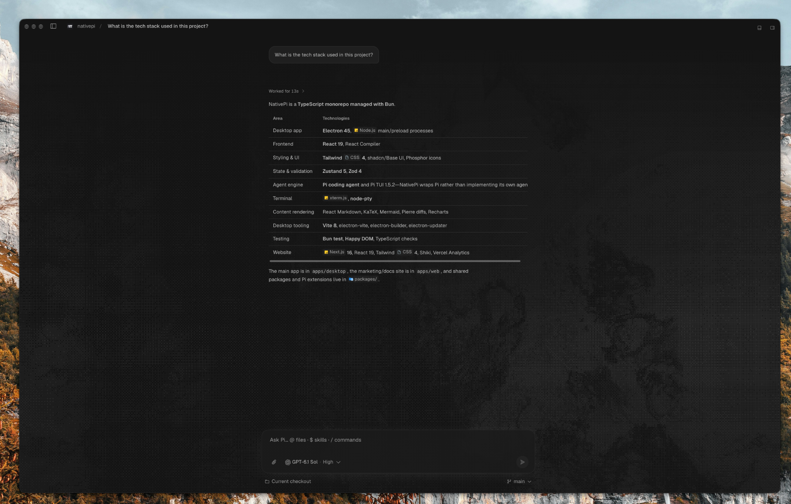
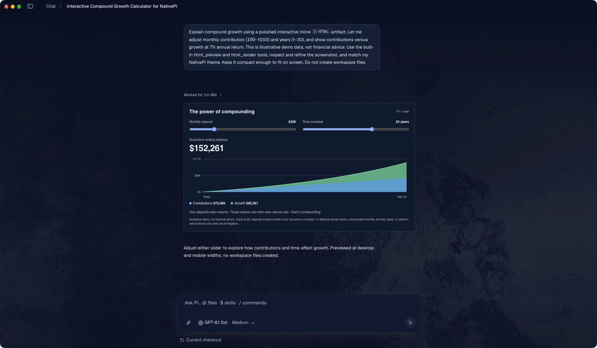
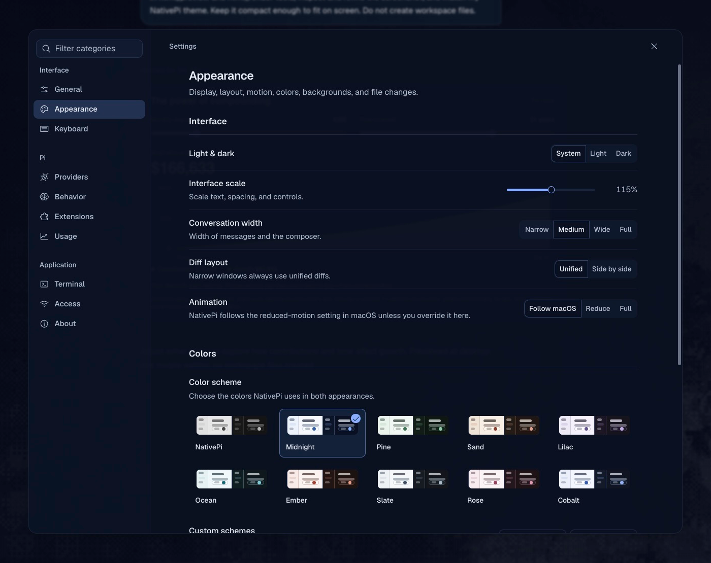

<p align="center">
  
</p>

<p align="center">
  <strong>A desktop workspace for the Pi coding agent.</strong><br>
  Free and open source for Windows, macOS, and Linux.
</p>

<p align="center">
  <a href="https://github.com/nonlooped/nativepi/releases/latest">Download</a> ·
  <a href="./CHANGELOG.md">Changelog</a> ·
  <a href="./CONTRIBUTING.md">Contribute</a>
</p>

NativePi brings the [Pi coding agent](https://pi.dev/) into a desktop workspace
for conversations, research, and hands-on project work. Chat without choosing a
project, or work alongside your files, diffs, and terminals in one window.

Pi is included. NativePi uses your existing Pi models, credentials,
configuration, sessions, and third-party extensions; no separate Pi installation
or NativePi account is required.



## Install

[Download Stable](https://github.com/nonlooped/nativepi/releases/latest) or get
the latest changes from [Nightly releases](https://github.com/nonlooped/nativepi/releases).
Installers are available for Windows x64, macOS Intel and Apple Silicon, and
Linux x64 and ARM64.

Connect a model provider in **Settings → Providers** if you have not already
configured Pi. Start in **Chat** for questions and research, or choose **Work**
to open a local project folder or work without a project. You can also drop a
project folder onto the window.

Installers are unsigned, and macOS builds are not notarized, so Windows
SmartScreen and macOS Gatekeeper may show warnings. Choose Stable or Nightly in
**Settings → About**. Windows and Linux install updates when the app quits;
unsigned macOS builds offer a manual download.

## Chat and Work

**Chat** is for questions, research, explanations, and drafts. Organize chats in
colored folders, search the web, and explore answers through interactive HTML
artifacts. Chat disables Pi's built-in file-writing tools and instructs the agent
to keep shell use read-only. It is a conversational profile, not a sandbox.

**Work** gives Pi its normal tools for coding and tasks on your device. Choose a
project or **No project**, run multiple chats at once, and keep files, source
control, and split terminals beside the conversation. Search, pin, and finish
threads as you go.

Both use ordinary Pi session files. NativePi adds the interface, built-in tools,
and instructions through Pi's APIs.

<details>
<summary>See Chat with an interactive artifact</summary>



</details>

## In the workspace

- **Web search and page reading.** Built into Chat and Work through Exa, with no
  search account or API key required. The anonymous service has rate limits.
- **Interactive HTML artifacts.** Explore charts, diagrams, and small tools
  inline, expand them fullscreen, or download the HTML. Snapshots are saved with
  the conversation and follow the app theme.
- **Control the conversation.** Steer, queue, or stop a run; attach images;
  reference local files with `@`, find skills with `$`, and run `/` commands in
  Work. Expand thinking, tool output, and file changes when you need the details.
- **Choose how Pi runs.** Browse models by provider, save favorites, and adjust
  reasoning and Standard/Priority service tiers where supported. Chats get
  automatic titles, and Pi can ask focused questions through native dialogs.
- **Review and commit.** Browse project files and diffs, stage files or individual
  hunks, ask Pi to draft a commit message, commit, push, and fast-forward sync.
  Switch branches or add worktrees as projects.
- **Keep terminals close.** Split terminals side by side or top to bottom. They
  stay alive while hidden and when you switch projects.
- **Make it yours.** Light and dark appearances, built-in and custom color
  schemes, landscape or custom backgrounds, and rebindable shortcuts for chats,
  terminals, and source control. Inspect local cost and token usage in Settings.
- **Open it on another device.** Enable token-protected browser access over your
  local network or a temporary public link while the desktop app stays open.

<details>
<summary>See appearance settings</summary>



</details>

## Pi underneath

Pi handles model execution, provider authentication, configuration, tools,
extensions, and sessions. Your conversations remain in Pi's session format,
usable from the Pi CLI. Third-party Pi extensions remain supported, including
their terminal UI; the optional [graphical extension API](./packages/extension-api/README.md)
adds native controls and views. Chat extensions are explicitly enabled in Settings.

Chat mode, web access, HTML artifacts, chat naming, questions, and service-tier
controls ship with the app. No NativePi extension packages are needed. If you
used the old packages, see the [upgrade guide](./docs/upgrade.md).

NativePi stores conversations and interface preferences locally and has no
product accounts or NativePi-owned telemetry. Model requests use your configured
Pi providers; built-in web search and page reading send requests directly to
Exa. Browser access is optional and uses the running desktop app.

## Develop

You need [Bun](https://bun.sh/) and Git.

```sh
git clone https://github.com/nonlooped/nativepi.git
cd nativepi
bun install
bun run dev
```

See [Contributing](./CONTRIBUTING.md) for prerequisites and checks. The desktop
app lives in `apps/desktop`, the website in `apps/web`, and the graphical
extension API in `packages/extension-api`.

## Docs

- [Contributing](./CONTRIBUTING.md)
- [Product scope](./apps/desktop/PRODUCT.md)
- [Graphical extension API](./packages/extension-api/README.md)
- [Release process](./docs/release.md)
- [Upgrading from retired packages](./docs/upgrade.md)
- [Security policy](./SECURITY.md)
- [Changelog](./CHANGELOG.md)
- [MIT License](./LICENSE)
